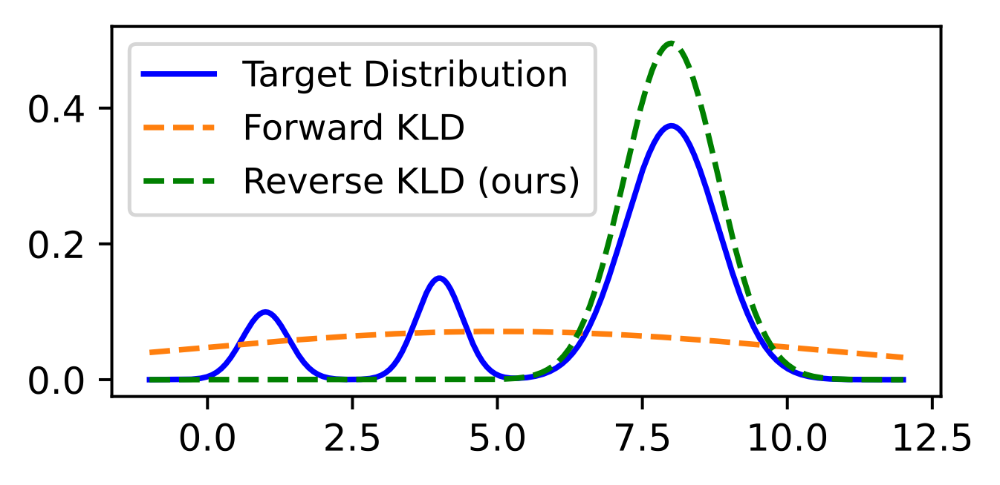

## 1. Definition of KL Divergence

The Kullback-Leibler (KL) divergence between two probability distributions $P$ and $Q$ is defined for discrete distributions as

$$
D_{\mathrm{KL}}(P \parallel Q) = \sum_{x} p(x) \log \frac{p(x)}{q(x)}
$$

(1)

and for continuous distributions as

$$
D_{\mathrm{KL}}(P \parallel Q) = \int p(x) \log \frac{p(x)}{q(x)} \, \mathrm{d}x.
$$

(2)

In both cases, it can be written in expectation form as

$$
D_{\mathrm{KL}}(P \parallel Q) = \mathbb{E}_{x \sim P} \left[ \log \frac{p(x)}{q(x)} \right].
$$

(3)

## 2. Quantitative Intuition: How Easy Is It to Confuse Two Distributions?

KL divergence is often described as a way to "measure the distance between distributions." More precisely, given two distributions, we want a quantitative measure of how similar they are—or equivalently, how easy it is to confuse them.

Consider two coins:
- **Real coin ($P$):** heads with probability $p_1$, tails with probability $p_2$.
- **Coin 2 ($Q$):** heads with probability $q_1$, tails with probability $q_2$.

Suppose we draw $N$ observations from the real coin ($P$), yielding approximately $N p_1$ heads and $N p_2$ tails. To quantify how easy it is to confuse Coin 2 with the real coin based on these observations, we take the ratio of the likelihood of the observations under the real coin to their likelihood under Coin 2:

$$
\frac{P(\text{observations} \mid \text{real coin})}{P(\text{observations} \mid \text{coin 2})} = \frac{p_1^{N p_1} p_2^{N p_2}}{q_1^{N p_1} q_2^{N p_2}}.
$$

(4)

Taking the $N$-th root to obtain the per-observation likelihood ratio and then taking the logarithm gives:

$$
\begin{aligned}
&\log \left( \frac{p_1^{N p_1} p_2^{N p_2}}{q_1^{N p_1} q_2^{N p_2}} \right)^{\frac{1}{N}} \\
&\quad = \frac{N p_1}{N} \log p_1 + \frac{N p_2}{N} \log p_2 - \frac{N p_1}{N} \log q_1 - \frac{N p_2}{N} \log q_2 \\
&\quad = p_1 \log p_1 + p_2 \log p_2 - p_1 \log q_1 - p_2 \log q_2 \\
&\quad = p_1 \log \frac{p_1}{q_1} + p_2 \log \frac{p_2}{q_2} = D_{\mathrm{KL}}(P \parallel Q).
\end{aligned}
$$

(5)

## 3. Why Is KL Divergence Not Symmetric?

In general, KL divergence is asymmetric:

$$
D_{\mathrm{KL}}(P \parallel Q) \neq D_{\mathrm{KL}}(Q \parallel P).
$$

(6)

We can interpret the two directions in terms of surprise:
- **$D_{\mathrm{KL}}(P \parallel Q)$:** If we sample from $P$ while evaluating under (or expecting) $Q$, how surprised are we by the observations?
- **$D_{\mathrm{KL}}(Q \parallel P)$:** If we sample from $Q$ while evaluating under (or expecting) $P$, how surprised are we by the observations?

Returning to the coin example illustrates why these two values differ. Suppose:
- **Coin 1 ($P$, fair):** $p_1 = 0.5$ (heads, 50%), $p_2 = 0.5$ (tails, 50%).
- **Coin 2 ($Q$, biased):** $q_1 = 1.0$ (heads, 100%), $q_2 = 0.0$ (tails, 0%).

**Case 1: Sampling from Coin 1 ($P$) and evaluating under Coin 2 ($Q$).**

$$
\begin{aligned}
D_{\mathrm{KL}}(P \parallel Q) &= p_1 \log \frac{p_1}{q_1} + p_2 \log \frac{p_2}{q_2} \\
&= 0.5 \log \frac{0.5}{1} + 0.5 \log \frac{0.5}{0} \to +\infty.
\end{aligned}
$$

(7)

Since Coin 1 yields tails half the time while Coin 2 assigns zero probability to tails, observing tails from Coin 1 is infinitely surprising under Coin 2.

**Case 2: Sampling from Coin 2 ($Q$) and evaluating under Coin 1 ($P$).**

$$
\begin{aligned}
D_{\mathrm{KL}}(Q \parallel P) &= q_1 \log \frac{q_1}{p_1} + q_2 \log \frac{q_2}{p_2} \\
&= 1 \times \log \frac{1}{0.5} + 0 \times \log \frac{0}{0.5} = \log 2.
\end{aligned}
$$

(8)

Using the standard convention $0 \log 0 = 0$, sampling from Coin 2 only produces heads, which still has probability $0.5$ under Coin 1, giving a finite divergence of $\log 2$. Hence, $D_{\mathrm{KL}}(P \parallel Q) \neq D_{\mathrm{KL}}(Q \parallel P)$.

## 4. Forward KL vs. Reverse KL in On-Policy Distillation

This asymmetry plays a central role in **On-Policy Distillation (OPD)** for large language models (LLMs).

At decoding step $t$, conditioned on input $x$ and prefix $\hat{y}_{<t}$, let $p_t$ be the student distribution and $q_t$ be the teacher distribution over vocabulary token $v$:

$$
p_t(v) := \pi_{\text{student}}(v \mid x, \hat{y}_{<t}), \qquad q_t(v) := \pi_{\text{teacher}}(v \mid x, \hat{y}_{<t}).
$$

(9)

The two divergence objectives are **Forward KL** (from teacher to student),

$$
D_{\mathrm{KL}}(q_t \parallel p_t) = \sum_{v} q_t(v) \log \frac{q_t(v)}{p_t(v)} = \mathbb{E}_{v \sim q_t} \left[ \log \frac{q_t(v)}{p_t(v)} \right],
$$

(10)

and **Reverse KL** (from student to teacher),

$$
D_{\mathrm{KL}}(p_t \parallel q_t) = \sum_{v} p_t(v) \log \frac{p_t(v)}{q_t(v)} = \mathbb{E}_{v \sim p_t} \left[ \log \frac{p_t(v)}{q_t(v)} \right].
$$

(11)

Which distribution provides the expectation (summation) weights—$q_t$ in Forward KL versus $p_t$ in Reverse KL—leads to completely different optimization behaviors.

### 4.1 Forward KL: Mode-Covering

Forward KL exhibits **mode-covering** behavior. It requires the student distribution $p_t$ to cover all regions where the teacher distribution $q_t$ is non-zero as thoroughly as possible.

The reason is that whenever there exists a token $v$ with $q_t(v) > 0$ while $p_t(v) \approx 0$, the term $q_t(v) \log \frac{q_t(v)}{p_t(v)}$ grows toward $+\infty$, causing the KL divergence to become extremely large.

As a result, a student trained with Forward KL cannot afford to leave out any response pattern that the teacher might adopt, and tends to distribute probability mass evenly across all modes present in the teacher distribution. When the teacher is a multimodal distribution (for example, when there are multiple valid response styles for the same prompt), the student dares not miss any mode: as long as the teacher assigns probability to an answer, the student must assign probability to it as well. Consequently, the student is forced to flatten its distribution, spreading probability mass thinly across every peak. The resulting model generates responses that jump back and forth between different styles without performing well on any single one.

### 4.2 Reverse KL: Mode-Seeking

Reverse KL exhibits **mode-seeking** behavior. Because the expectation in $D_{\mathrm{KL}}(p_t \parallel q_t)$ is taken under the student's own distribution $p_t$, the student is only responsible for the high-probability tokens that it samples itself.

As long as the student's sampling probability $p_t(v)$ on a token is very low, the probability assigned by the teacher to that token has little impact. Conversely, whenever the student assigns a relatively high probability $p_t(v)$ to a token, the teacher's probability $q_t(v)$ on that token must not be too low; otherwise $\log \frac{p_t(v)}{q_t(v)}$ becomes very large.

Therefore, the student's optimal strategy is to select one peak within the region supported by the teacher—specifically a mode where the student already has high probability—and concentrate all of its probability mass on that peak while ignoring the remaining modes. Intuitively, Reverse KL encourages the student to pick one mode from the teacher's multimodal distribution that it also favors and commit all probability mass to that mode.

This is precisely the behavior desired in LLM post-training: rather than greedily imitating every possible response style, the model selects the most suitable and stable response style and outputs it consistently and coherently. This not only improves output stability, but also mitigates the forgetting issue caused by forcing the model to cover new distributions.

<figure id="fig-mode-behavior"><figcaption>Figure 1: Comparison of Forward KLD (mode-covering) and Reverse KLD (mode-seeking) when fitting a multimodal target distribution. Source: <a href="https://arxiv.org/pdf/2306.08543" target="_blank" rel="noopener noreferrer">arXiv:2306.08543</a>.</figcaption></figure>

